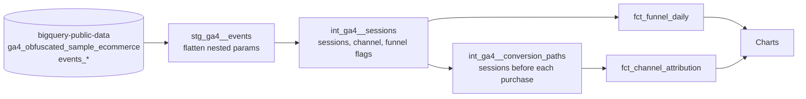
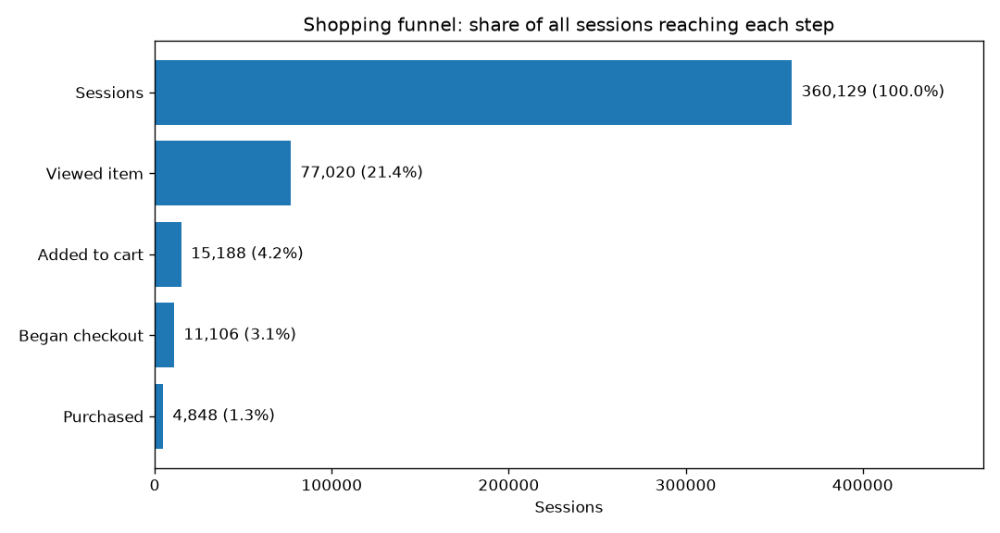
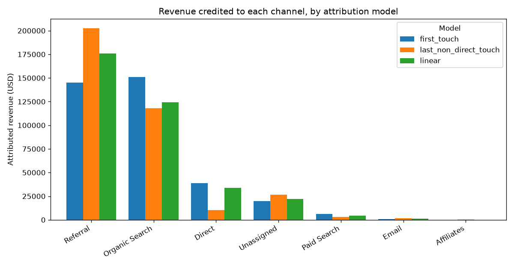
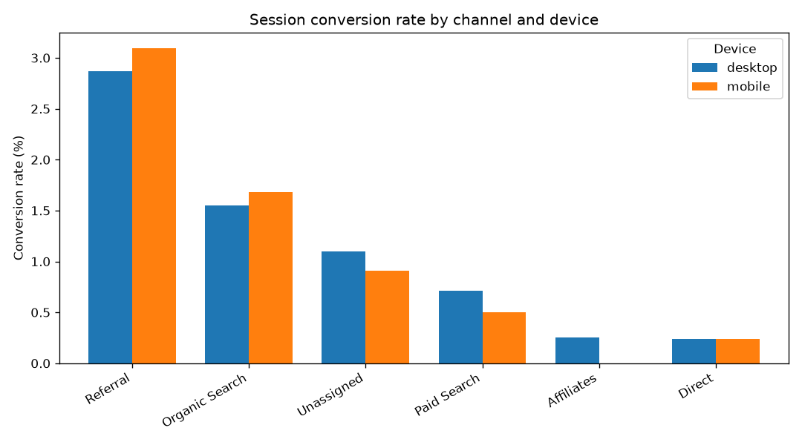

# GA4 Funnel & Attribution Analysis


How much credit does each marketing channel deserve for a sale? The answer depends on
which attribution model you pick, and most teams never see the models side by side.

This project models **real GA4 data** from the Google Merchandise Store (Google's public
BigQuery export) with **dbt on BigQuery**. It rebuilds sessions from raw events, maps traffic
into channels, measures the shopping funnel, and compares **first-touch, last non-direct
touch, and linear attribution** on the same purchases.

> Built by a performance marketer who has spent years reading these numbers in the GA
> interface, to show how they're actually calculated underneath.

## Key findings

<!-- Fill these in from your own charts after running the project. Use real numbers. -->
- **Funnel:** _X% of sessions view a product, Y% add to cart, Z% purchase. The biggest drop is at ..._
- **Attribution:** _Channel A gets N% more revenue credit under first-touch than last-touch, which suggests ..._
- **Device:** _Desktop converts at X% vs mobile at Y% ..._

## Architecture



| Layer | Model | What it does |
|---|---|---|
| Staging | `stg_ga4__events` | Unnests GA4's `event_params` into flat columns; the only model that scans raw data |
| Intermediate | `int_ga4__sessions` | Rebuilds sessions (GA4 has no session table), picks traffic source, assigns channel |
| Intermediate | `int_ga4__conversion_paths` | Every session a buyer had in the 30 days up to their purchase |
| Mart | `fct_funnel_daily` | View item → add to cart → checkout → purchase, by day, device and channel |
| Mart | `fct_channel_attribution` | Purchases and revenue by channel under three attribution models |

## Results







## Attribution models

| Model | Who gets credit |
|---|---|
| **First touch** | The first session in the 30-day path |
| **Last non-direct touch** | The last session that wasn't Direct (similar to GA4's own default for paid/organic channels). All-Direct paths stay Direct |
| **Linear** | Every session in the path gets an equal share |

A custom dbt test (`assert_attribution_reconciles`) proves each model hands out exactly
100% of purchases and revenue, with nothing double-counted or dropped.

## Assumptions and limitations

- **Sessions** are `user_pseudo_id` + `ga_session_id`, the standard approach for GA4's BigQuery export.
- **Session source** is the first source/medium recorded in the session; sessions with none are treated as Direct, matching GA4 convention.
- **The data is obfuscated by Google.** Some values appear as `<Other>` or `(data deleted)`; these land in the *Unassigned* channel.
- `user_pseudo_id` identifies a browser or device, not a person, so cross-device paths look like separate users.
- The dataset covers 2020-11-01 to 2021-01-31, so paths near the start are truncated.

## Run it yourself

Needs a free Google Cloud project (the BigQuery sandbox works; no credit card).

```bash
git clone https://github.com/AJVALLONE/ga4-funnel-attribution.git
cd ga4-funnel-attribution
python3 -m venv .venv && source .venv/bin/activate
pip install -r requirements.txt

gcloud auth application-default login
cp .env.example .env               # then set GCP_PROJECT to your project ID

make dev      # one week of data: fast and nearly free
make all      # full three months + charts
```

## What I'd add next

- Position-based (40/20/40) and data-driven (Markov chain) attribution
- Product-level funnel: which items get added to cart but not bought
- Incremental models partitioned by date for a live (non-sample) GA4 property
